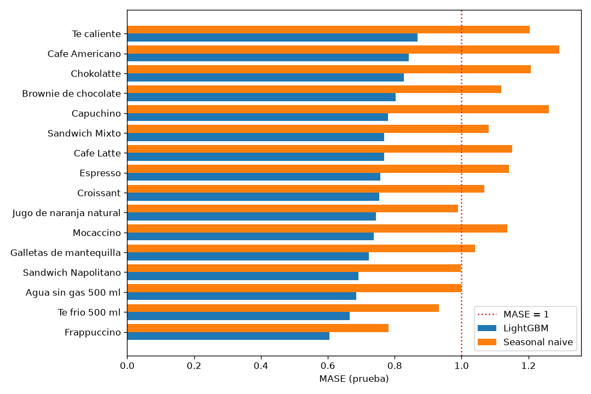
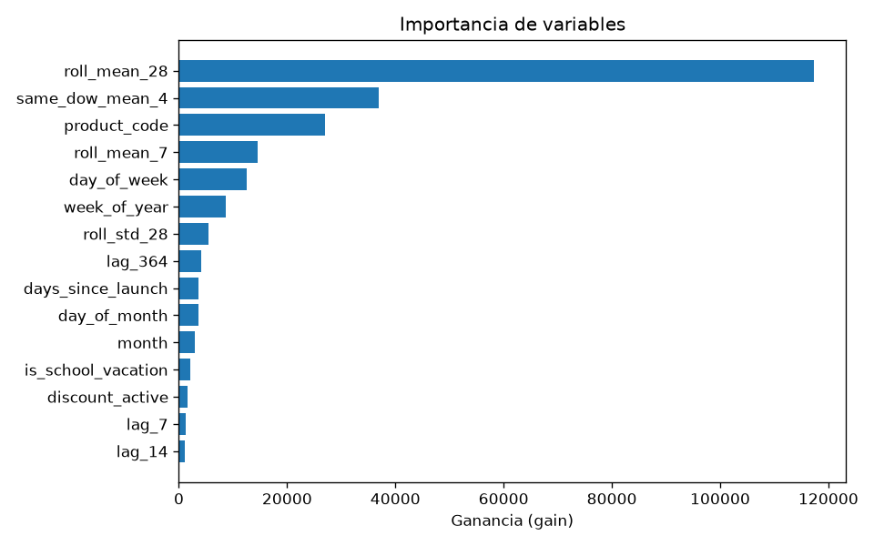
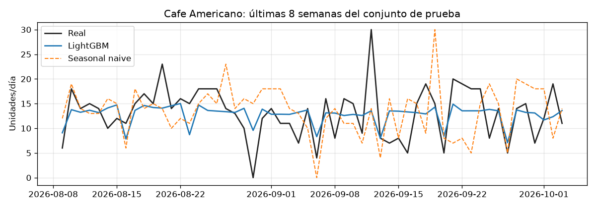
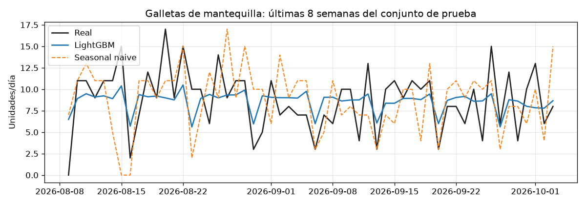
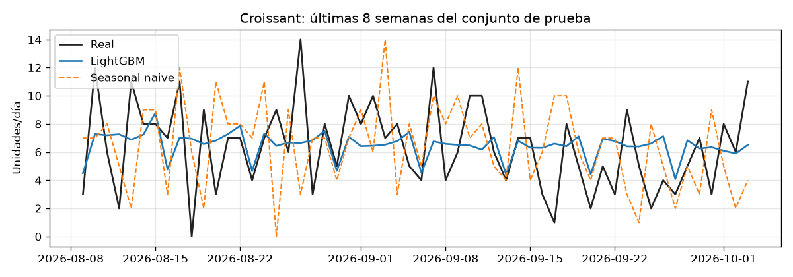

# Análisis de errores — conjunto de prueba

Modelo `lgbm-202610101258` · prueba 2026-04-01 → 2026-10-03 · 2944 filas producto×día · 16 productos activos.
Se excluyen 2 días de cierre por feriado (el sistema devuelve 0 por regla) y los productos discontinuados (se reportan aparte).

## 1. Resultado global

| Método | MASE (macro) | MASE (agregado) | MAE | RMSE | WAPE | Sesgo |
|---|---|---|---|---|---|---|
| LightGBM | 0.751 | 0.756 | 2.129 | 2.780 | 0.357 | -0.232 |
| Seasonal naive (t-7) | 1.088 | 1.101 | 3.102 | 4.052 | 0.520 | -0.068 |
| Media 4 mismos días | 0.856 | 0.863 | 2.431 | 3.195 | 0.408 | -0.088 |

- MASE se escala con el MAE del *seasonal naive* (t-7) dentro del periodo de desarrollo (entrenamiento + validación) de cada producto.
- LightGBM obtiene MASE = **0.751** frente a **1.088** de la línea base; criterio de éxito (MASE < 1): **cumplido**.
- El sesgo de LightGBM (-0.232 u/día) indica una leve tendencia a subestimar la demanda, propia de los objetivos tweedie/L1 que apuntan a la mediana.

## 2. Error por producto

| Producto | MASE LightGBM | MASE seasonal naive | MAE LightGBM | MAE seasonal naive | Sesgo LightGBM |
|---|---|---|---|---|---|
| Te caliente | 0.869 | 1.204 | 1.683 | 2.332 | -0.289 |
| Cafe Americano | 0.842 | 1.293 | 3.559 | 5.462 | -1.028 |
| Chokolatte | 0.827 | 1.207 | 2.234 | 3.261 | -0.201 |
| Brownie de chocolate | 0.803 | 1.118 | 2.455 | 3.418 | -0.197 |
| Capuchino | 0.779 | 1.262 | 2.913 | 4.717 | -0.413 |
| Sandwich Mixto | 0.769 | 1.081 | 2.173 | 3.054 | -0.173 |
| Cafe Latte | 0.768 | 1.151 | 2.611 | 3.913 | -0.648 |
| Espresso | 0.757 | 1.142 | 1.899 | 2.864 | -0.386 |
| Croissant | 0.753 | 1.068 | 2.218 | 3.147 | -0.118 |
| Jugo de naranja natural | 0.744 | 0.989 | 1.802 | 2.397 | 0.209 |
| Mocaccino | 0.738 | 1.137 | 1.926 | 2.967 | -0.226 |
| Galletas de mantequilla | 0.722 | 1.041 | 2.775 | 4.000 | -0.577 |
| Sandwich Napolitano | 0.692 | 0.997 | 1.493 | 2.152 | 0.071 |
| Agua sin gas 500 ml | 0.686 | 0.999 | 1.432 | 2.087 | 0.110 |
| Te frio 500 ml | 0.665 | 0.932 | 1.171 | 1.641 | -0.215 |
| Frappuccino | 0.605 | 0.782 | 1.720 | 2.223 | 0.365 |

## 3. Error por día de la semana

| Segmento | Filas | MAE LightGBM | MAE seasonal naive | Sesgo LightGBM |
|---|---|---|---|---|
| Lunes | 416 | 2.188 | 3.118 | -0.071 |
| Martes | 416 | 2.153 | 3.103 | -0.399 |
| Miércoles | 432 | 2.120 | 3.102 | -0.167 |
| Jueves | 432 | 2.197 | 3.201 | -0.687 |
| Viernes | 400 | 2.190 | 3.420 | -0.284 |
| Sábado | 432 | 2.285 | 3.285 | -0.257 |
| Domingo | 416 | 1.764 | 2.488 | 0.253 |

## 4. Segmentos difíciles

| Segmento | Filas | MAE LightGBM | MAE seasonal naive | Sesgo LightGBM |
|---|---|---|---|---|
| Días normales | 2838 | 2.114 | 3.048 | -0.212 |
| Víspera de cierre por feriado | 32 | 2.129 | 3.062 | -0.251 |
| Una semana después de un cierre (t-7 = 0) | 32 | 2.015 | 5.844 | -0.115 |
| Días con descuento | 42 | 3.202 | 4.690 | -1.698 |
| Vacaciones escolares (julio) | 496 | 1.955 | 2.853 | -0.307 |

## 5. Mayores errores absolutos

| Fecha | Producto | Real | LightGBM | Seasonal naive |
|---|---|---|---|---|
| 2026-09-12 | Cafe Americano | 30 | 13.55 | 14 |
| 2026-05-07 | Cafe Latte | 22 | 8.38 | 6 |
| 2026-06-19 | Cafe Americano | 28 | 14.90 | 15 |
| 2026-05-09 | Cafe Americano | 27 | 14.71 | 17 |
| 2026-07-28 | Capuchino | 20 | 9.49 | 12 |
| 2026-04-02 | Capuchino | 19 | 8.71 | 8 |
| 2026-06-29 | Cafe Americano | 4 | 14.16 | 10 |
| 2026-05-12 | Chokolatte | 15 | 5.01 | 5 |
| 2026-08-08 | Galletas de mantequilla | 0 | 9.96 | 11 |
| 2026-07-09 | Cafe Americano | 21 | 11.14 | 12 |

## 6. Productos discontinuados

- **Agua con gas 500 ml** (última venta 2026-03-27): demanda real media 0.00; MAE LightGBM 0.99, MAE seasonal naive 0.03.

## 7. Simulación de sobrantes y faltantes

Si cada día se preparara `ceil(pronóstico)` unidades de los productos con stock (Agua sin gas 500 ml, Brownie de chocolate, Croissant, Galletas de mantequilla, Te frio 500 ml) durante 184 días (demanda real total 5090 u):

| Método | Unidades sobrantes | Unidades faltantes |
|---|---|---|
| LightGBM | 1073 | 802 |
| Seasonal naive (t-7) | 1292 | 1338 |
| Media 4 mismos días | 1196 | 897 |

## 8. Importancia de variables

## 9. Ejemplos de pronóstico

